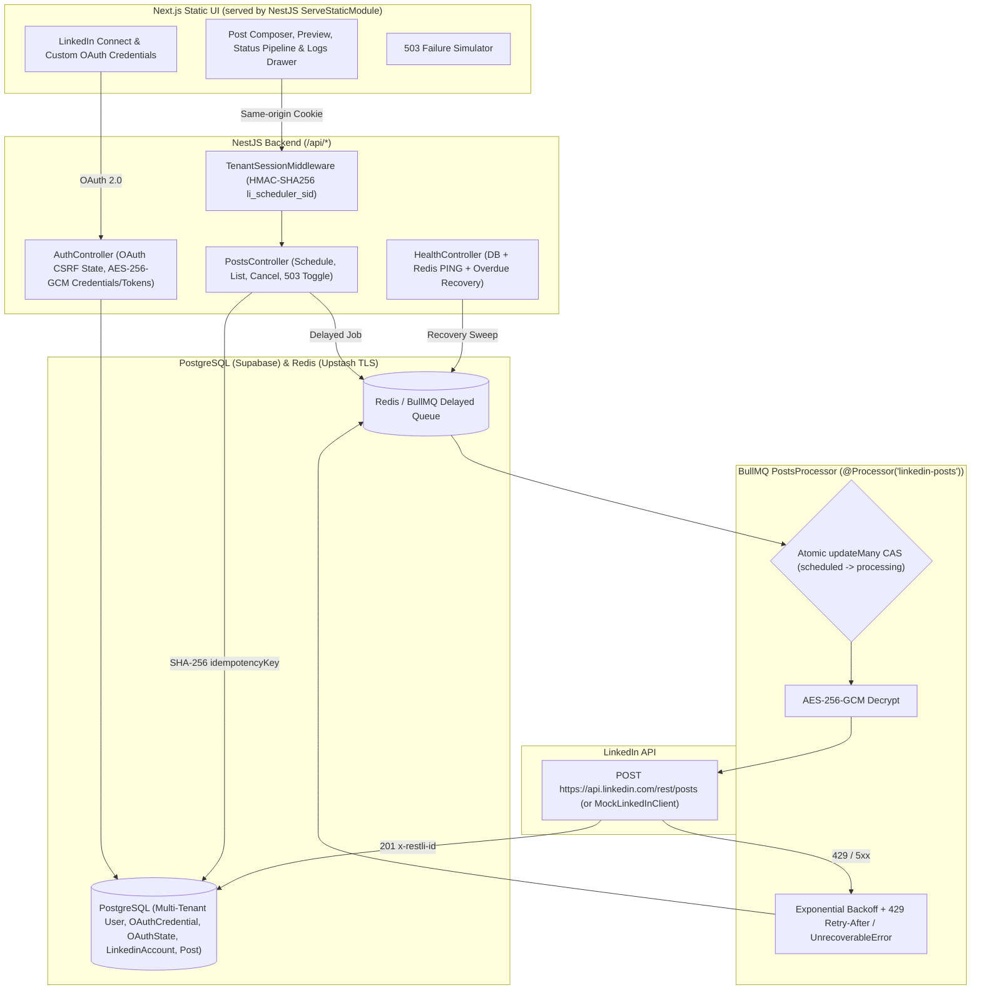

# LinkedIn Post Scheduler & Publisher

Full-stack TypeScript application built with **NestJS**, **BullMQ (Redis / Upstash TLS)**, **PostgreSQL (Prisma)**, and **Next.js (static export)** served from a single Render Web Service.

---

## 1. Architecture Diagram



---

## 2. Core Guarantees

- **Multi-Tenant Session Isolation**: `TenantSessionMiddleware` issues an HMAC-SHA256 signed `HttpOnly` cookie (`li_scheduler_sid`) per browser. Each visitor's OAuth credentials, tokens, and posts are isolated in PostgreSQL without requiring sign-up.
- **Zero-Trust Token & Credential Storage**: LinkedIn access tokens and optional user-entered `Client ID` / `Client Secret` are encrypted at rest with **AES-256-GCM** (96-bit IV + 128-bit auth tag).
- **Duplicate-Post Protection**:
  1. Deterministic `SHA-256(userId + content + scheduledFor)` `idempotencyKey` (`UNIQUE` in PostgreSQL -> `409 Conflict`).
  2. Atomic `prisma.post.updateMany({ where: { id, status: 'scheduled' }, data: { status: 'processing' } })` Compare-And-Swap claim in `PostsProcessor`.
  3. BullMQ deterministic `jobId` (`post-${id}`) and job cancellation on `POST /api/posts/:id/cancel`.
- **Resilient Retries**:
  - Transient errors (`429` honoring `Retry-After`, `500`–`504`) reset `status = 'scheduled'`, increment `retryCount`, and re-run via BullMQ exponential backoff (`2s * 2^attempt + jitter`).
  - Terminal errors (`400`, `401`, `403`, expired/undecryptable tokens) mark `status = 'failed'` and throw `UnrecoverableError`.
- **Render Free-Tier Resilience**: `GET /api/health` checks Postgres `SELECT 1`, Redis `PING`, and runs an overdue-post recovery sweep so an external ping (e.g., `cron-job.org` every 5–10 min) keeps the worker awake and recovers missed jobs.

---

## 3. PostgreSQL Database Schema

Defined in [`prisma/schema.prisma`](prisma/schema.prisma):
- `User` (`id`, `sessionId` unique)
- `OAuthCredential` (`userId` unique, AES-256-GCM encrypted `clientId` & `clientSecret`)
- `OAuthState` (`state` PK, `userId`, `expiresAt` — single-use CSRF state)
- `LinkedinAccount` (`userId` unique, `linkedinPersonUrn`, `linkedinName`, AES-256-GCM encrypted `accessToken`, `expiresAt`)
- `Post` (`id`, `userId`, `linkedinAccountId`, `content`, `scheduledFor`, `status`, `idempotencyKey` unique, `bullmqJobId`, `retryCount`, `maxRetries`, `lastError`, `externalPostUrn`, `publishedAt`)

---

## 4. Local Setup & Verification

```bash
# 1. Install dependencies (pnpm only)
pnpm install

# 2. Configure environment
cp .env.example .env
# Set DATABASE_URL (PostgreSQL), REDIS_URL, ENCRYPTION_MASTER_KEY (64 hex), SESSION_SECRET (32+ chars)

# 3. Push schema & run tests
pnpm db:push
pnpm test

# 4. Build NestJS + Next.js static export
pnpm build
pnpm start
```

Or run everything locally with Docker Compose (Postgres 16 + Redis 7 + App):
```bash
docker compose up --build
```

Run the deployment debugger / smoke suite against local or live URL:
```bash
pnpm smoke -- --url http://localhost:3000
```

---

## 5. Live Deployment Guide (Render Free Tier + Supabase + Upstash)

### Step 1: Supabase PostgreSQL (Free Tier)
1. Create a free project in Supabase and copy the **Connection String** (Transaction/Session pooler or Direct URI with `?sslmode=require`).
2. Save it as `DATABASE_URL`.

### Step 2: Upstash Redis (Free Tier)
1. Create a free Redis database in [Upstash](https://upstash.com).
2. Copy the `rediss://default:<password>@<host>:<port>` TLS URL and save it as `REDIS_URL`.

### Step 3: LinkedIn Developer App
1. Open the [LinkedIn Developer Portal](https://developer.linkedin.com) and create an app linked to a LinkedIn Page.
2. Under **Products**, enable **Share on LinkedIn** (`w_member_social`) and **Sign In with LinkedIn using OpenID Connect** (`openid`, `profile`, `email`).
3. Under **Auth -> Authorized redirect URLs**, add:
   `https://<your-render-service>.onrender.com/api/auth/linkedin/callback`
4. Copy **Client ID** and **Client Secret**.

### Step 4: Deploy to Render
1. Push this repository to GitHub.
2. In Render, create a **New Blueprint** (uses `render.yaml`) or **Web Service** from your repo.
3. Set the remaining environment variables (`DATABASE_URL`, `REDIS_URL`, `ENCRYPTION_MASTER_KEY` 64-hex chars, `LINKEDIN_CLIENT_ID`, `LINKEDIN_CLIENT_SECRET`, `LINKEDIN_REDIRECT_URI`, `USE_MOCK_LINKEDIN=false`).
4. Once live, verify with the deployment debugger:
   ```bash
   pnpm smoke -- --url https://<your-render-service>.onrender.com
   ```

### Step 5: Prevent Render Free-Tier Sleep
Create a free monitor on [cron-job.org](https://cron-job.org) or UptimeRobot hitting `GET https://<your-render-service>.onrender.com/api/health` every 5–10 minutes.
