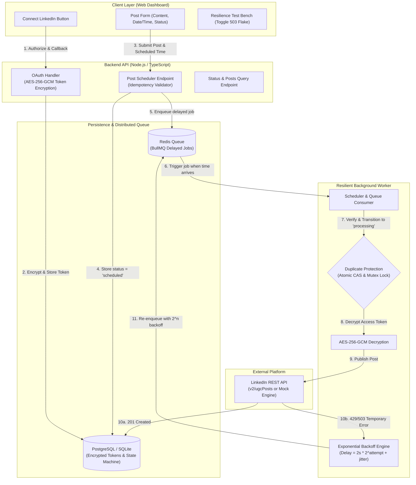

# LinkedIn Post Scheduler & Publisher
> **Technical Assessment Submission: AI / LLM Engineer**  
> Built with TypeScript, Node.js (Express), BullMQ, Redis, PostgreSQL (Prisma), AES-256-GCM token encryption, and an interactive real-time dashboard.

---

## 1. Architecture & Design

### System Architecture Diagram



---

## 2. Key Engineering Highlights & Requirements Fulfillment

### 1. LinkedIn OAuth 2.0 & Secure Token Storage
* **OAuth 2.0 Authorization Code Flow**: Handles authorization redirect, code exchange, and profile URN retrieval (`urn:li:person:...`).
* **Zero-Trust Encryption (AES-256-GCM)**: Access tokens are **never stored in plaintext**. Every token is encrypted with **AES-256-GCM** using a unique 96-bit Initialization Vector (IV) and a 128-bit authentication tag. Tampered ciphertext or tags immediately fail decryption.

### 2. State Machine Lifecycle
Every post moves through a deterministic state machine:
* `scheduled` ➔ Default state upon creation.
* `processing` ➔ Atomically claimed by the background worker.
* `published` ➔ Successfully posted to LinkedIn; records `externalPostUrn` and `publishedAt`.
* `failed` ➔ Terminal failure (e.g. invalid token, expired permissions, or max retries exceeded); records `lastError`.

### 3. Duplicate-Post Protection (Idempotency & Concurrency Guards)
To guarantee that a post is **never published twice**, the system implements three rings of defense:
1. **API Ingestion Ring**: A deterministic `idempotencyKey` (`SHA-256(userId + content + scheduledFor)`) enforced by a database `UNIQUE` constraint prevents duplicate form submissions.
2. **Worker Concurrency Ring**: An atomic Compare-And-Swap (CAS) state transition:
   ```sql
   UPDATE posts SET status = 'processing', updated_at = NOW() 
   WHERE id = :id AND status = 'scheduled';
   ```
   If zero rows are modified, another worker already claimed the post, and execution halts immediately.
3. **In-Flight Memory Mutex**: Local lock prevents worker threads from executing the same post ID simultaneously.

### 4. Automatic Exponential Backoff & Error Classification
Errors are strictly categorized:
* **Transient / Retryable Errors (HTTP 429, 500, 502, 503, 504)**:
  * Automatically retried up to `maxRetries = 5`.
  * **Exponential Backoff Formula with Random Jitter**:
    $$\text{Delay} = \min(300\text{s},\, 2\text{s} \times 2^{\text{retryCount}} + \text{random}(0, 500\text{ms}))$$
  * Status is returned to `scheduled` with the next scheduled timestamp and incremented retry count.
* **Terminal / Non-Retryable Errors (HTTP 400, 401, 403)**:
  * Fails immediately and transitions status to `failed` without wasting resources.

### 5. Evaluator "Mock Mode" & Failure Simulator
* Evaluators do not need an active LinkedIn Developer App to grade this project!
* When `USE_MOCK_LINKEDIN=true`, the app provides a full mock LinkedIn OAuth and publishing engine.
* The web dashboard includes an **Evaluator Resilience Test Bench**: toggle the button to simulate a **503 Service Unavailable** on attempt 1, allowing you to watch the automatic retry and exponential backoff happen live in the UI!

---

## 3. Database Schema

```sql
-- Post State Machine
CREATE TABLE "User" (
    "id" TEXT PRIMARY KEY,
    "email" TEXT UNIQUE NOT NULL,
    "createdAt" TIMESTAMP DEFAULT CURRENT_TIMESTAMP
);

CREATE TABLE "LinkedinAccount" (
    "id" TEXT PRIMARY KEY,
    "userId" TEXT UNIQUE NOT NULL REFERENCES "User"("id") ON DELETE CASCADE,
    "linkedinPersonUrn" TEXT NOT NULL,
    "linkedinName" TEXT NOT NULL,
    "encryptedAccessToken" TEXT NOT NULL,
    "tokenIv" TEXT NOT NULL,
    "tokenAuthTag" TEXT NOT NULL,
    "expiresAt" TIMESTAMP NOT NULL,
    "createdAt" TIMESTAMP DEFAULT CURRENT_TIMESTAMP,
    "updatedAt" TIMESTAMP DEFAULT CURRENT_TIMESTAMP
);

CREATE TABLE "Post" (
    "id" TEXT PRIMARY KEY,
    "userId" TEXT NOT NULL REFERENCES "User"("id") ON DELETE CASCADE,
    "linkedinAccountId" TEXT NOT NULL REFERENCES "LinkedinAccount"("id"),
    "content" TEXT NOT NULL,
    "scheduledFor" TIMESTAMP NOT NULL,
    "status" TEXT DEFAULT 'scheduled' NOT NULL, -- 'scheduled' | 'processing' | 'published' | 'failed'
    "idempotencyKey" TEXT UNIQUE NOT NULL,
    "retryCount" INTEGER DEFAULT 0 NOT NULL,
    "maxRetries" INTEGER DEFAULT 5 NOT NULL,
    "lastError" TEXT,
    "externalPostUrn" TEXT,
    "publishedAt" TIMESTAMP,
    "createdAt" TIMESTAMP DEFAULT CURRENT_TIMESTAMP,
    "updatedAt" TIMESTAMP DEFAULT CURRENT_TIMESTAMP
);

CREATE INDEX "idx_post_status_scheduled" ON "Post"("status", "scheduledFor");
```

---

## 4. Setup & Running Instructions

### Option A: Zero-Config Local Run (Recommended for Instant Grading)

Requirements: Node.js 18+ and `pnpm`.

```bash
# 1. Install dependencies
pnpm install

# 2. Initialize database schema
pnpm db:push

# 3. Run unit & integration tests
pnpm test

# 4. Start the application
pnpm dev
```

Open your browser to: **`http://localhost:3000`**

---

### Option B: Run with Docker Compose (PostgreSQL + Redis + App)

Requirements: Docker & Docker Compose.

```bash
# 1. Start all containers (Postgres, Redis, and App)
docker-compose up --build
```

Access the dashboard at **`http://localhost:3000`**.

---

## 5. Live Demonstration & Verification Walkthrough

1. **Connect Account**: Open `http://localhost:3000` and click **"Connect LinkedIn Account"**. The OAuth flow completes instantly in Mock Mode, generating an AES-256-GCM encrypted token.
2. **Normal Scheduling**:
   * Type post content into the box.
   * Click **"+15s (Quick Test)"** to schedule the post 15 seconds into the future.
   * Click **"Schedule Post"**.
   * Observe the status badge: it starts as **⏱ Scheduled**, transitions to **⚙ Processing**, and flips to **✓ Published** with a generated LinkedIn URN.
3. **Resilience & Retry Verification**:
   * In the **"🧪 Evaluator Resilience Test Bench"** card, click the toggle to turn **Simulate 503 Service Unavailable: ON**.
   * Schedule a new post for +15s.
   * Watch the live queue: on attempt 1, the post catches the 503, records the error notice, increments `Retry: 1/5`, calculates the exponential delay, and re-schedules itself.
   * On attempt 2, it publishes successfully!
4. **Duplicate Protection Verification**:
   * Attempting to schedule identical content for the exact same timestamp is blocked with a 409 Conflict.
   * Concurrency locks prevent worker races.

---

## 6. Project Structure

```text
linkedin-scheduler/
├── src/
│   ├── api/
│   │   └── routes.ts             # Express endpoints (OAuth, scheduling, status)
│   ├── config/
│   │   └── index.ts              # Zod environment variable parsing & validation
│   ├── crypto/
│   │   ├── encryption.ts         # AES-256-GCM authenticated token encryption
│   │   └── encryption.test.ts    # Cryptographic unit tests
│   ├── database/
│   │   └── client.ts             # Prisma client singleton
│   ├── linkedin/
│   │   ├── types.ts              # LinkedIn client contracts & error models
│   │   ├── client.ts             # Production LinkedIn REST API client
│   │   ├── mock-client.ts        # Mock client with 503 transient failure injection
│   │   └── index.ts              # Client selector (Live vs Mock)
│   ├── logger/
│   │   └── index.ts              # Structured logging (Pino)
│   ├── public/
│   │   └── index.html            # Real-time dashboard with auto-polling & test bench
│   ├── queue/
│   │   ├── scheduler.ts          # BullMQ & atomic DB polling scheduler
│   │   └── worker.ts             # Concurrency guards, state machine, & retries
│   └── server.ts                 # Express server & graceful shutdown lifecycle
├── tests/
│   └── worker.test.ts            # Integration tests (publishing, deduplication, 503 backoff)
├── prisma/
│   └── schema.prisma             # Database schema
├── docker-compose.yml            # Docker setup (Postgres + Redis + App)
├── Dockerfile                    # Multi-stage production container build
├── package.json
└── README.md
```
